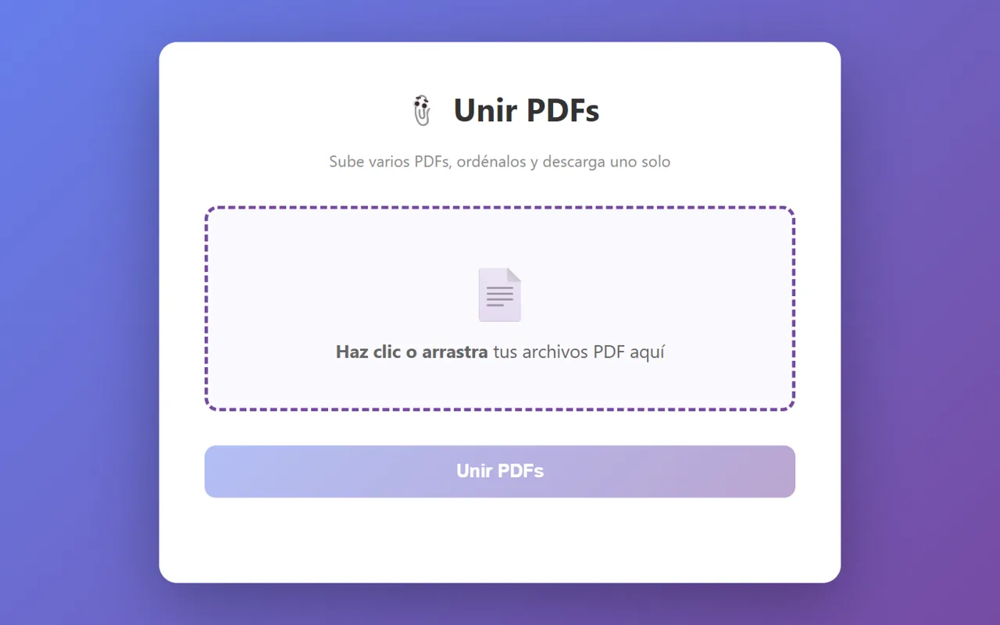

<p align="center"><a href="README.md">Español</a> · <b>English</b></p>

# Merge PDF



Merges several PDFs into one from a local page. The files never leave your computer and are processed in memory (up to 500 MB in total).

## Usage

```sh
git clone https://github.com/virtuanista/unir-pdf.git
cd unir-pdf
pip install -r requirements.txt
python app.py
```

Open `http://127.0.0.1:5000`, add at least two PDFs and download the result.

## License

Code under [MIT](LICENSE). Uses [Flask](https://flask.palletsprojects.com/) and [pypdf](https://github.com/py-pdf/pypdf), both BSD-licensed.

<p align="center">
	Repository made by <a href="https://github.com/virtuanista" target="_blank">virtu 🎣</a>
</p>

<p align="center">
	
</p>

<p align="center">
	Copyright &copy; 2026
</p>

<p align="center">
	<a href="LICENSE"></a>
</p>
