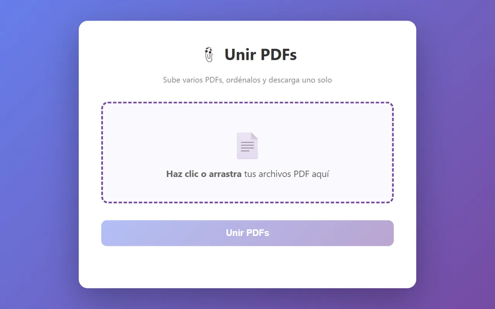

# Unir PDF



Une varios PDF en uno solo desde una página local. Los archivos no salen de tu equipo y se procesan en memoria (hasta 500 MB en total).

## Usar

```sh
git clone https://github.com/virtuanista/unir-pdf.git
cd unir-pdf
pip install -r requirements.txt
python app.py
```

Abre `http://127.0.0.1:5000`, añade al menos dos PDF y descarga el resultado.

## Licencia

Código bajo [MIT](LICENSE). Usa [Flask](https://flask.palletsprojects.com/) y [pypdf](https://github.com/py-pdf/pypdf), ambos con licencia BSD.

<p align="center">
	Repositorio generado por <a href="https://github.com/virtuanista" target="_blank">virtu 🎣</a>
</p>

<p align="center">
	
</p>

<p align="center">
	Copyright &copy; 2026
</p>

<p align="center">
	<a href="LICENSE"></a>
</p>
